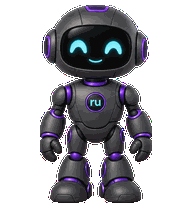
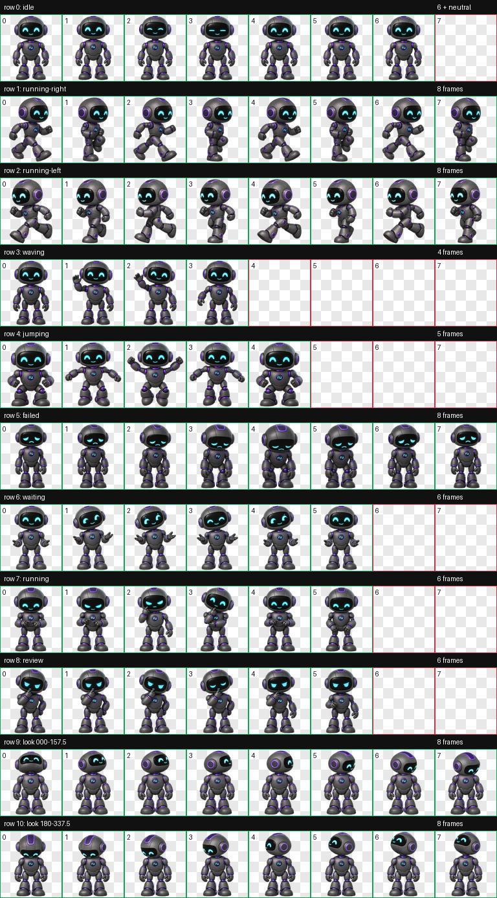

# ruPet

A friendly little robot companion for the ChatGPT / Codex desktop pet system, created by [ruvnet](https://github.com/ruvnet).

Rounded charcoal shell. Expressive cyan eyes. Purple accents. A tiny **ru** emblem.



Inspired by building and coordinating intelligent agents, ruPet blinks, waves, jumps, gets curious, and follows your pointer with its head.

## Download

**[Download ruPet.zip](https://github.com/ruvnet/ruPet/releases/latest/download/ruPet.zip)** from the latest release.

The ready-to-install ZIP contains `pet.json`, `spritesheet.webp`, and the license. A copy is also available in [dist/ruPet.zip](dist/ruPet.zip).

## Install

Use a desktop app version that supports custom **v2 pets**. This package supplies the pet artwork and animation metadata; it does not run a separate application.

1. Download and extract `ruPet.zip`.
2. Create a folder named `rupet` inside your local pets directory:

   | Platform | Folder |
   | --- | --- |
   | Windows | `%USERPROFILE%\.codex\pets\rupet\` |
   | macOS | `~/.codex/pets/rupet/` |

   If you have set `CODEX_HOME`, use `<CODEX_HOME>/pets/rupet/` instead.

3. Put **both extracted files directly inside** that folder:

   ```text
   pets/
     rupet/
       pet.json
       spritesheet.webp
   ```

4. In the desktop app, open **Settings → Pets**, select **Refresh**, then choose **ruPet**.
5. Enter `/pet` to show the floating pet. Enter it again to hide it.

You can also drag the pet to reposition it. See the [official Pets documentation](https://learn.chatgpt.com/docs/pets) for current controls and availability.

### If ruPet does not appear

- Make sure the two files are directly inside `pets/rupet/`, not an additional nested ZIP folder.
- Check whether your app uses a custom `CODEX_HOME` location.
- Refresh the pet list or restart the desktop app.
- Update the app if it does not support `spriteVersionNumber: 2`.
- If the Pets feature is missing, check the official documentation and your workspace's availability settings.

This release targets the **desktop v2 pet format**. It is not packaged for the separate web pet upload format. Custom desktop pets are installed locally; each recipient installs their own copy.

## Optional assistant guidance

The pet is artwork. Selecting it does **not** enable tools, load instructions, or start an autonomous agent. For tool-aware assistance, use the separate guidance in this repository:

- [Assistant prompt](prompts/assistant.md): paste into a tool-enabled chat.
- [Creation prompt](prompts/create-rupet.md): create or repair ruPet using the installed `hatch-pet` and `imagegen` skills.
- [ruPet skill](skills/rupet/SKILL.md): companion behavior plus optional Ruflo routing and creation guidance.

To install the optional skill, download or clone this repository and copy the **entire `skills/rupet` folder**, including its `references` and `agents` subfolders, to your local skills directory:

| Platform | Skill folder |
| --- | --- |
| Windows | `%USERPROFILE%\.codex\skills\rupet\` |
| macOS | `~/.codex/skills/rupet/` |

Use `<CODEX_HOME>/skills/rupet/` if configured. Keep any existing custom skill backed up before replacing it. Reload skills or restart the app, then invoke `$rupet` in a chat. The pet ZIP is unchanged and does not install this optional skill.

The guidance discovers available tools rather than assuming a particular server. It uses Ruflo memory for relevant lessons, routing for useful delegation, and persistent tracking only when needed. Native tools handle ordinary file work. Missing optional Ruflo tools do not block the pet or ordinary assistance.

See [tool selection and memory](skills/rupet/references/tool-routing.md) and [creation and repair workflow](skills/rupet/references/creation-workflow.md). Advanced AgentDB, RuVector, RVF, and other services are used only when the task actually calls for them; the prompt does not install or activate services automatically.

## Animations

| State | Frames | Behavior |
| --- | ---: | --- |
| Idle | 6 | Gentle movement and blinking |
| Running right | 8 | Playful stride and recovery |
| Running left | 8 | Playful stride and recovery |
| Waving | 4 | A friendly greeting |
| Jumping | 5 | Crouch, lift, and settle |
| Failed | 8 | A deflated, sympathetic reaction |
| Waiting | 6 | An expectant request for input |
| Running a task | 6 | Focused processing and thinking |
| Review | 6 | Thoughtful inspection |
| Look directions | 16 | Clockwise gaze poses using head turns and tilts |

The walking cycles use a stylized stride/recovery rhythm. Looking transitions favor expressive poses over mechanically exact angle spacing.

<details>
<summary>View the full animation sheet</summary>



The checkerboard is part of this review preview. The actual sprite asset has a transparent background.

</details>

## Package details

- Pet ID: `rupet`
- Display name: `ruPet`
- Format: `spriteVersionNumber: 2`
- Sprite atlas: lossless WebP with alpha, **1536 × 2288** pixels
- Grid: **8 columns × 11 rows**, with **192 × 208** pixel cells
- Contents: pet metadata and artwork only; no executable code, account credentials, or conversation data

The sheet passed format, transparency, and frame checks, visual review of all nine animation sequences, and three independent blind reviews of its gaze directions. Artwork was generated with OpenAI image generation and assembled and validated using the hatch-pet workflow.

## Share and remix

Share the release link or ZIP with friends. They can install it using the steps above.

To publish your own variant, use a different folder name and `id` in `pet.json`, choose a new `displayName`, and keep the sprite version and atlas geometry compatible. Include the license when redistributing the original artwork or substantial portions of it.

## License

[MIT](LICENSE) © 2026 ruvnet. Permission to use, share, modify, and redistribute is granted under the included license.

ruPet is a community-created pet and is not an official OpenAI product.

<!-- ruv-constellation:manifest -->
## ruv constellation

[manifest.ruv](manifest.ruv) describes this repository with source-pinned capability evidence. Explore the [ruvnet nexus](https://github.com/ruvnet/ruvnet/blob/main/docs/ruv-catalog.md) and [manifest contract](https://github.com/ruvnet/ruvnet/blob/main/docs/ruv-manifest.md). Declared integration roles are discovery metadata and do not grant execution authority or certify runtime behavior.
